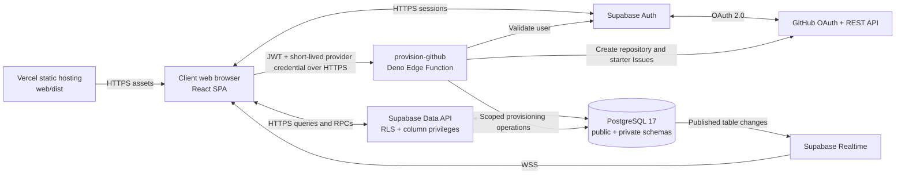
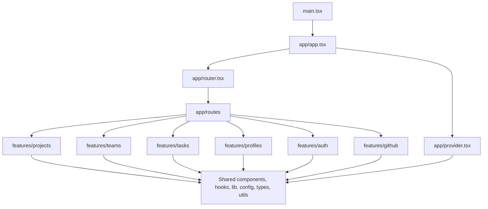
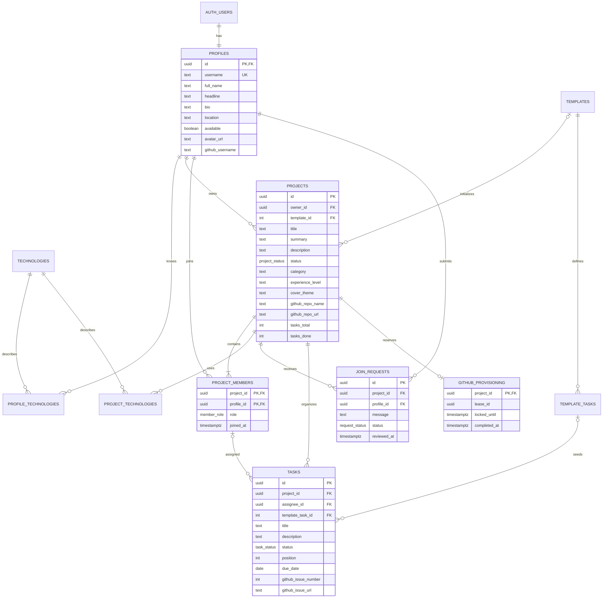
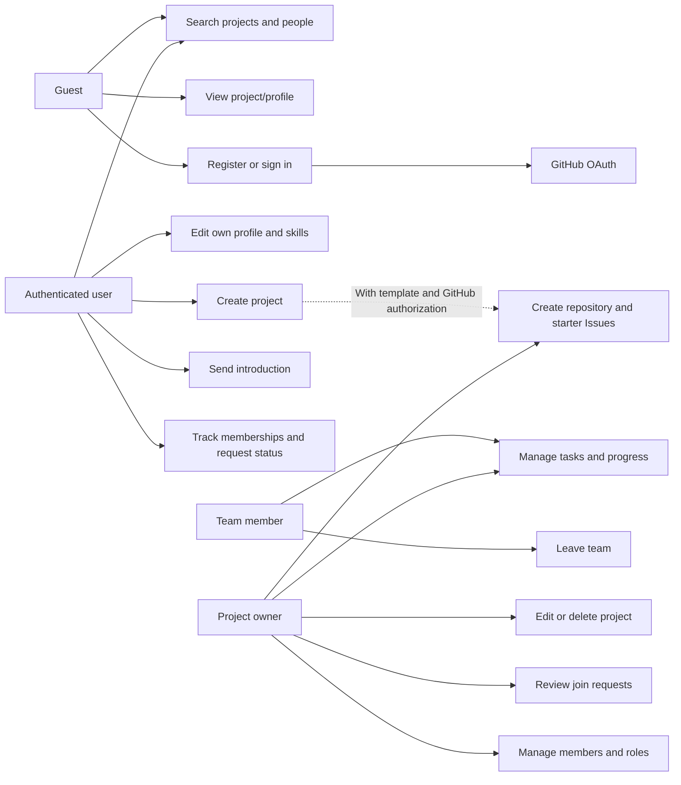

# CollabCode architecture

This document maps the supplied deployment, entity-relationship, and use-case diagrams to the implementation. The product remains a React + TypeScript single-page application on Vercel, using Supabase Auth, PostgreSQL, Realtime, and Edge Functions. GitHub supplies OAuth and optional repository/Issue provisioning.

## Deployment

Vercel serves static assets only. Database and GitHub authorization run in Supabase. The browser never receives a service-role key. Vercel's `web/vercel.json` rewrites client routes to the HTML shell so deep links such as `/projects/:id` work after refresh.

## Frontend layers

An arrow indicates an allowed dependency. No feature imports another feature. Pages combine feature components and APIs, while shared modules have no knowledge of pages or product features. A feature may contain `api`, `components`, `hooks`, `types`, or `utils` when needed; unused subfolders are not created.

The shared Supabase client is typed from `types/database.ts`. TanStack Query owns fetched data, retries, and invalidation. React state owns transient controls. There is no separate client database or global state store.

### Routes and composition

| Route                           | Module                                      | Access                                        |
| ------------------------------- | ------------------------------------------- | --------------------------------------------- |
| `/`, `/projects`                | `app/routes/explore.tsx`                    | Public discovery                              |
| `/people`                       | `app/routes/people.tsx`                     | Public people search                          |
| `/people/:id`                   | `app/routes/profile.tsx`                    | Public profile + membership-based projects    |
| `/auth/login`, `/auth/register` | `app/routes/auth.tsx`                       | Email or GitHub sign-in                       |
| `/auth/callback`                | `AuthCallbackRoute` in the auth route       | PKCE callback completion                      |
| `/projects/new`                 | `app/routes/create-project.tsx`             | Authenticated                                 |
| `/projects/:id`                 | `app/routes/project.tsx`                    | Public overview/team; private task/owner tabs |
| `/workspace`                    | `app/routes/workspace.tsx`                  | Authenticated memberships + outgoing requests |
| `/settings`                     | `ProfileSettingsRoute` in the profile route | Own profile                                   |

`app/router.tsx` guards authenticated routes, lazily loads pages, and composes the shared shell with profile/session data. Project tabs use `?tab=tasks`, `team`, `requests`, or `settings`. The database independently enforces permissions even if a URL or API call is crafted manually.

## Entity relationships

The SQL migrations are the authoritative source for exact columns, constraints, defaults, and indexes. Standard creation/update timestamps omitted from the diagram above remain in the relevant tables.

### Deliberate refinements to the supplied ER diagram

| Refinement                                        | Reason                                                                                                                                        |
| ------------------------------------------------- | --------------------------------------------------------------------------------------------------------------------------------------------- |
| Add `projects.owner_id`                           | Provide a direct, immutable owner for simple RLS, while retaining the owner membership.                                                       |
| Add public profile headline/location/availability | Support people discovery and the richer profile described in the brief.                                                                       |
| Add project summary/category/experience/color     | Keep discovery cards useful without overloading the description.                                                                              |
| Add trigger-maintained task counters to projects  | Publish aggregate progress while keeping task contents team-only.                                                                             |
| Composite task-assignee membership FK             | An assignee must be a member of that same project; departure clears the assignment.                                                           |
| Add `template_task_id` and uniqueness             | Trace seeded work and prevent duplicate template tasks.                                                                                       |
| Unique `(project_id, profile_id)` join request    | Prevent duplicate introductions; pending/rejected requests can be withdrawn to retry. Former members may also clear an old accepted request.  |
| Omit `github_connections.access_token`            | No persistent provider credentials are needed for this flow. The browser keeps the token only in memory; the function uses it per invocation. |
| Add service-only `github_provisioning`            | Serialize provisioning attempts using an expiring lease; store no tokens.                                                                     |

### Enumerations

| Enum             | Values                                   |
| ---------------- | ---------------------------------------- |
| `project_status` | `recruiting`, `in_progress`, `completed` |
| `member_role`    | `owner`, `maintainer`, `member`          |
| `request_status` | `pending`, `accepted`, `rejected`        |
| `task_status`    | `todo`, `in_progress`, `done`            |

## Permissions

| Action                             | Guest | Signed-in non-member | Member / maintainer | Owner                                 |
| ---------------------------------- | ----- | -------------------- | ------------------- | ------------------------------------- |
| Browse projects/profiles/teams     | Yes   | Yes                  | Yes                 | Yes                                   |
| Edit own profile                   | No    | Yes                  | Yes                 | Yes                                   |
| Create a project                   | No    | Yes                  | Yes                 | Yes                                   |
| Ask to join a recruiting project   | No    | Yes                  | Already a member    | Already the owner                     |
| Read an introduction               | No    | Own only             | Own only            | All for own project                   |
| Read/create/edit/delete tasks      | No    | No                   | Yes                 | Yes                                   |
| Edit/delete project                | No    | No                   | No                  | Yes                                   |
| Accept/reject join requests        | No    | No                   | No                  | Yes                                   |
| Change roles/remove another member | No    | No                   | No                  | Yes, excluding owner                  |
| Leave project                      | No    | No                   | Yes                 | No                                    |
| Provision GitHub                   | No    | No                   | No                  | Yes, with linked GitHub authorization |

Profiles contain no email address. Email stays in Supabase Auth. Public membership is deliberate; task content and application messages are not public. RLS and column grants protect direct API requests. The UI's disabled buttons and hidden tabs are convenience, not security.

## Use cases

### Creating a project

1. The authenticated page collects the idea, stack, required skills, theme, and optional template.
2. `public.save_project` runs as the caller and inserts the project with `owner_id = auth.uid()`.
3. A private trigger adds the owner membership and copies the approved template's tasks. Task triggers update public progress counters.
4. The same RPC writes technology associations. Any error rolls back the whole transaction.
5. If GitHub provisioning was selected and a provider credential is present, the page invokes `provision-github`. GitHub failure preserves the created CollabCode project and displays a retryable message.

### Accepting an introduction

The owner updates the request's status. RLS authorizes the owner, and a private `BEFORE UPDATE` trigger validates the pending → accepted/rejected transition, inserts membership for acceptance, and assigns `reviewed_at`. All steps commit together. A conflicting second review cannot produce a second membership or silently replace the first decision.

### Task progress and realtime

Members write tasks under RLS. A private trigger applies counter deltas to the project, avoiding a public read of private task descriptions. The project route subscribes to project, membership, request, and task events. Invalidated query results are refetched under the current caller's permissions. A 30-second fallback also handles missed/delete events and reconnects. Drag-and-drop changes task status; dropdowns provide a keyboard-accessible equivalent. Within-column custom ordering is not implemented even though the schema retains `position` for starter order.

### GitHub provisioning

1. Reject unapproved browser origins and unauthenticated callers.
2. Verify the Supabase session with `auth.getUser` and require the authenticated project owner.
3. Verify the GitHub token's `/user` identity matches the linked GitHub identity in Supabase Auth.
4. Claim a five-minute service-only lease for that project.
5. Reuse the linked/deterministically named repository, or create one. External template repositories must be approved in `templates` and marked as templates on GitHub.
6. Persist the repository link immediately. Built-in starters use a single Git tree/commit and a non-forced reference update. `.collabcode.json` makes retries identifiable. Existing source is not overwritten.
7. Match starter Issues by embedded task-ID markers. Create only missing Issues and persist their links.
8. Release the lease. If execution stops abruptly, the lease expires. No rollback deletes GitHub data.

Github Issue markers are metadata inside the body, not executable instructions. User descriptions are rendered as plain React text in the app and are never used as code. The function intentionally does not add collaborators or mirror later Kanban status edits to GitHub.

## UI and accessibility

The page hierarchy emphasizes discovery, then a project overview, then the team's work. The desktop shell becomes a dismissible mobile drawer. Forms have labels, constraints, error states, pending feedback, and native controls. Destructive actions use native modal dialogs. Navigation has a skip link, visible focus indicators, semantic landmarks, and reduced-motion support. Project tasks can move without dragging. External GitHub links are restricted to HTTPS on `github.com`.

Visual inspection remains to be performed in an available browser; responsive CSS is not a substitute for that inspection. No Lighthouse or HTML validator scores are claimed.

## References

- [Bulletproof React project structure](https://github.com/alan2207/bulletproof-react/blob/master/docs/project-structure.md)
- [Supabase row-level security](https://supabase.com/docs/guides/database/postgres/row-level-security)
- [Supabase Realtime Postgres changes](https://supabase.com/docs/guides/realtime/postgres-changes)
- [Supabase GitHub sign-in](https://supabase.com/docs/guides/auth/social-sign-in/auth-github)
- [GitHub repository/template API](https://docs.github.com/en/rest/repos/repos#create-a-repository-using-a-template)
- [GitHub Git trees and safe branch updates](https://docs.github.com/en/rest/git/trees#create-a-tree)
